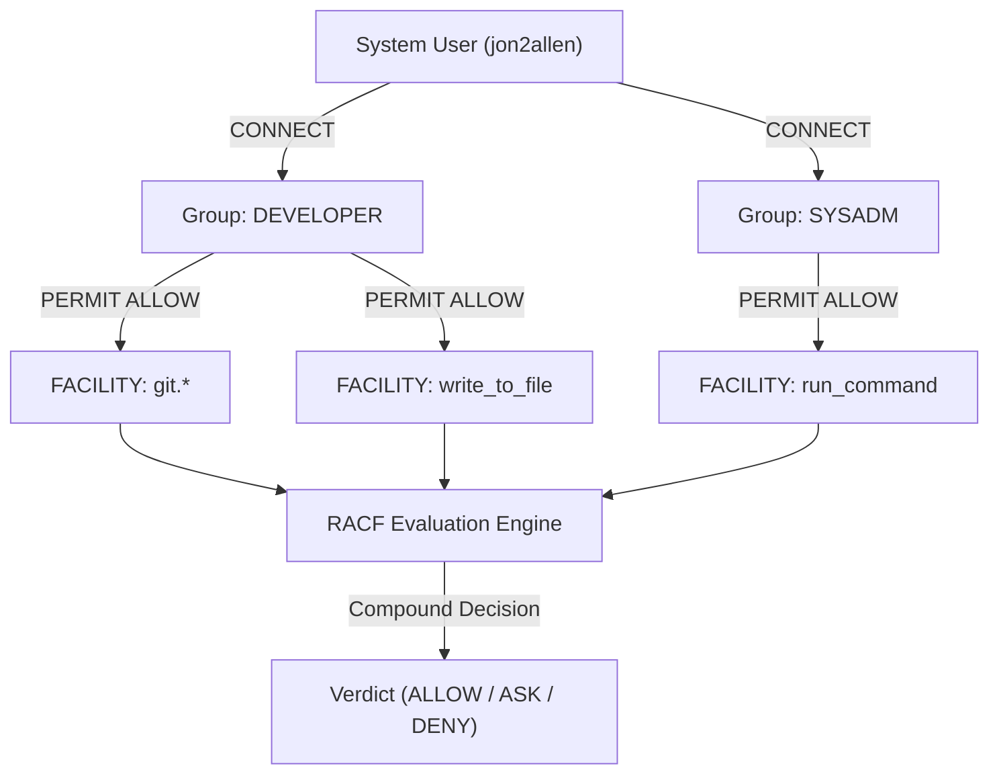
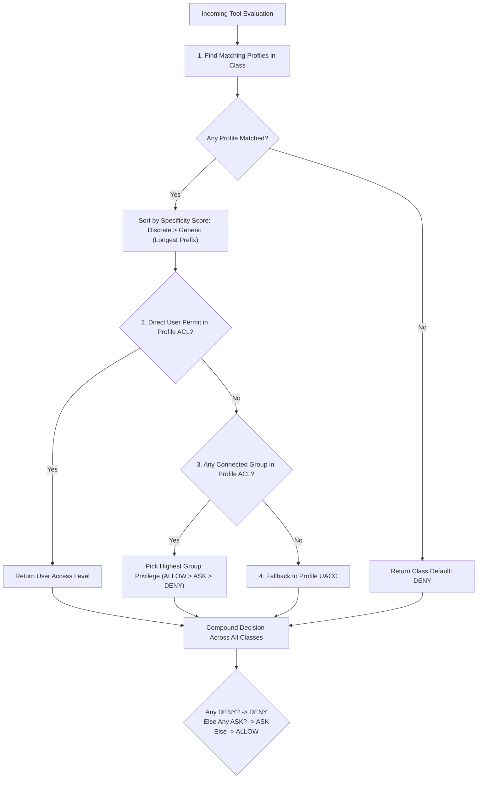

# RACF-Guard: Reference Binary Security Engine for Chatybot

A clean-slate reference implementation in Rust for Chatybot's external binary security adapter (`StdioBinaryPolicyEngine`), modeled after the IBM z/OS **RACF** (Resource Access Control Facility) architecture.

---

## 1. Overview & Concept

Chatybot supports pluggable security adapters via `StdioBinaryPolicyEngine`, where decisions can be delegated to an external process communicating over `stdin` and `stdout` using JSON.

`racf-guard` brings mainframe-grade access control concepts to AI agent operations:

- **Users (`USER`)**: System user IDs (e.g. `jon2allen`, `ci_bot`) mapped from `context.user` or the operating system login (`USER` / `LOGNAME`).
- **Groups (`GROUP`)**: Logical security roles that are **completely decoupled from OS groups** (e.g. `DEVELOPER`, `DEVOPS`, `SYSADM`, `AUDITOR`).
- **Resource Classes (`CLASS`)**:
  - `FACILITY`: Tools, MCP servers, and agent capabilities (e.g. `git.status`, `run_command`, `view_file`).
  - `DIR`: Filesystem directories and sensitive path hierarchies (e.g. `/etc/**`, `~/.ssh/**`, `/workspace/**`).
  - `COMMAND`: Shell command patterns executed by subshells (e.g. `git *`, `rm *`, `sudo *`).
- **Profiles & Generic Patterns**: Supports exact discrete profiles (`git.status`) as well as generic wildcard patterns (`git.*`, `/etc/**`).
- **Tri-State Verdicts**: RACF permissions map naturally to Chatybot's tri-state policy:
  - `ALLOW` / `READ` / `UPDATE` / `ALTER` &rarr; `allow`
  - `ASK` / `AUDIT` &rarr; `ask` (prompts human-in-the-loop)
  - `DENY` / `NONE` &rarr; `deny` (blocks execution immediately)

---

## 2. RACF Policy Syntax (.racf)

Policy rules are defined using standard RACF command syntax:

```racf
# -----------------------------------------------------------------------------
# User & Group Role Assignments
# -----------------------------------------------------------------------------
ADDGROUP DEVELOPER DATA('Application Developers')
ADDGROUP SYSADM    DATA('System Administrators')

CONNECT jon2allen GROUP(DEVELOPER)
CONNECT jon2allen GROUP(SYSADM)
CONNECT dev_user  GROUP(DEVELOPER)

# -----------------------------------------------------------------------------
# FACILITY Class: Tools and Capabilities
# -----------------------------------------------------------------------------
# Set universal access (UACC) fallback for unknown facilities to ASK
RDEFINE FACILITY * UACC(ASK)

# Git facilities
RDEFINE FACILITY git.* UACC(ASK)
PERMIT git.status CLASS(FACILITY) ID(DEVELOPER) ACCESS(ALLOW)
PERMIT git.diff   CLASS(FACILITY) ID(DEVELOPER) ACCESS(ALLOW)
PERMIT git.push   CLASS(FACILITY) ID(DEVELOPER) ACCESS(ASK)

# Read-only exploration tools
RDEFINE FACILITY view_file   UACC(ALLOW)
RDEFINE FACILITY list_dir    UACC(ALLOW)
RDEFINE FACILITY grep_search UACC(ALLOW)

# Subshell execution
RDEFINE FACILITY run_command CLASS(FACILITY) UACC(ASK)
PERMIT run_command CLASS(FACILITY) ID(SYSADM) ACCESS(ALLOW)

# -----------------------------------------------------------------------------
# DIR Class: Filesystem Boundaries
# -----------------------------------------------------------------------------
RDEFINE DIR /etc/**   UACC(DENY)
RDEFINE DIR /sys/**   UACC(DENY)
RDEFINE DIR /proc/**  UACC(DENY)
RDEFINE DIR ~/.ssh/** UACC(DENY)
RDEFINE DIR /tmp/**   UACC(ALLOW)
RDEFINE DIR /Users/** UACC(ALLOW)

# -----------------------------------------------------------------------------
# COMMAND Class: Shell Execution Controls
# -----------------------------------------------------------------------------
RDEFINE COMMAND rm*    UACC(DENY)
RDEFINE COMMAND sudo*  UACC(DENY)
RDEFINE COMMAND git*   UACC(ALLOW)
RDEFINE COMMAND cargo* UACC(ALLOW)
```

---

## 3. Evaluation Precedence

When Chatybot evaluates an action, `racf-guard` evaluates all relevant resource classes (`FACILITY`, plus `DIR` for file paths, plus `COMMAND` for shell executions):

1. **Profile Resolution**:
   - Discrete profiles (exact match) always take precedence over generic wildcard profiles.
   - For generic matches, the most specific profile (longest matching pattern) wins.
2. **Access Level Evaluation**:
   1. **Individual User Permit**: If the user has an explicit `PERMIT ... ID(<user>)`, it is applied immediately.
   2. **Group Permits**: If any group the user belongs to has an explicit `PERMIT ... ID(<group>)`, the user inherits group access (highest privilege wins: `ALLOW` > `ASK` > `DENY`).
   3. **Profile UACC**: If no individual or group permit exists on the winning profile, the profile's Universal Access (`UACC`) is applied.
   4. **Class Default**: If no profile matches, access is `DENY`.
3. **Compound Decision**:
   - If **any** evaluated resource is `DENY`, the overall decision is `DENY`.
   - Else if **any** evaluated resource is `ASK`, the overall decision is `ASK`.
   - If all resources are `ALLOW`, the overall decision is `ALLOW`.

---

## 4. Building the Binary

### Requirements
- Rust toolchain (`cargo` and `rustc` 1.75+)

### Compilation
```bash
cd tools/racf-guard
cargo build --release
```
The compiled binary is placed at `tools/racf-guard/target/release/racf-guard`.

---

## 5. Setup & Database Seeding

### Is the Database Empty or Seeded?

`racf-guard` supports both **seeded** and **clean-slate (empty)** setups:

1. **Seeded Reference Database (`examples/security.racf`)**:
   - The repository includes a pre-seeded policy template containing standard roles (`DEVELOPER`, `DEVOPS`, `SYSADM`, `AUDITOR`), git tool permissions, read-only allowances, destructive command blocks (`rm*`, `sudo*`), and directory locks (`/etc/**`, `~/.ssh/**`).
   - **Embedded Compiled Fallback**: If `racf-guard` is run with no policy file specified and none discovered on disk, the binary automatically falls back to an embedded baseline policy so it remains functional out of the box.

2. **Clean-Slate / Custom Policy**:
   - You can create your own `.racf` file from scratch.
   - If an empty or minimal `.racf` file is provided, `racf-guard` begins in a **strict fail-closed state**: any resource class (`FACILITY`, `DIR`, `COMMAND`) that has no matching profile defaults to **`DENY`**.

### How Policies Are Discovered & Loaded

When invoked, `racf-guard` searches for its policy definition in the following order of precedence:

1. **CLI Argument**: `--policy /path/to/policy.racf` (or `-p <path>`)
2. **Environment Variable**: `RACF_POLICY_PATH=/path/to/policy.racf`
3. **Local File Auto-Discovery**: Checks candidate paths:
   - `./security.racf`
   - `./examples/security.racf`
   - `tools/racf-guard/examples/security.racf`
4. **Embedded Seed Fallback**: Internal default rules compiled directly into the binary.

### Quick Setup Steps

#### Step 1: Compile the binary
```bash
cd tools/racf-guard
cargo build --release
```

#### Step 2: Customize or copy the seed policy
```bash
# Optional: Copy the reference seed policy to your user configuration
mkdir -p ~/.config/chatybot
cp tools/racf-guard/examples/security.racf ~/.config/chatybot/security.racf

# Add your username to the DEVELOPER or SYSADM group in ~/.config/chatybot/security.racf:
# CONNECT <your-username> GROUP(DEVELOPER)
```

#### Step 3: Verify the active rules
```bash
./target/release/racf-guard --policy ~/.config/chatybot/security.racf --list-rules
```

---

## 6. CLI Testing & Auditing

### Listing & Auditing All Rules
You can inspect the entire loaded security database, including all defined groups, user connects, resource classes, profiles (discrete vs generic), UACCs, and ACL permits:

```bash
./target/release/racf-guard --list-rules
# or alias
./target/release/racf-guard -l
```

### CLI Testing & Dry Run with Debug Tracing
You can evaluate access rights directly from the terminal without launching Chatybot:

```bash
# Check git.status for user jon2allen
./target/release/racf-guard --check --tool git.status --user jon2allen

# Run with verbose filtering trace showing evaluation decisions step-by-step
./target/release/racf-guard --check --tool git.status --user jon2allen --debug
```

### Stdio JSON Protocol & Debug Trace Forwarding
`racf-guard` communicates with Chatybot via standard JSON stdin/stdout. When Chatybot runs with `--security`, it passes `--debug` (or `context.debug = true`) to the binary. The binary writes its detailed filtering trace to `stderr`, where Chatybot surfaces it as `[Security Debug] [External Binary] ...`:

```bash
echo '{"tool":"git.status","context":{"user":"jon2allen","debug":true}}' | ./target/release/racf-guard
```

Output to `stdout`:
```json
{"status":"allow","reason":"RACF access permitted: User 'jon2allen' granted ALLOW via group 'DEVELOPER' on FACILITY:git.status"}
```

---

### Administrative Commands & Persistence (With Automated Backup)

You can mutate the RACF security database directly from the CLI. Because policy updates occur infrequently, `racf-guard` uses **Option 1 persistence with automated safety backups**:

1. **Safety Backup First**: Before appending or modifying the `.racf` file, a backup copy (`<filename>.bak`) is automatically created.
2. **Integrity Validation & Rollback**: The new statement is validated before write. If parsing fails, the original file is automatically restored from `<filename>.bak`.

#### 1. Connect a User to a Group
```bash
./target/release/racf-guard connect alice --group DEVELOPER
```
Output:
```text
[RACF Admin] Created backup copy: 'examples/security.racf.bak'
[RACF Admin] Persisted statement to 'examples/security.racf':
  CONNECT alice GROUP(DEVELOPER)
[RACF Admin] Database reloaded successfully (4 groups, 41 profiles).
```

#### 2. Define a Resource Profile (RDEFINE)
```bash
./target/release/racf-guard rdefine COMMAND "curl*" --uacc ASK
```

#### 3. Permit Access (PERMIT)
```bash
./target/release/racf-guard permit git.push --class FACILITY --id DEVELOPER --access ALLOW
```

#### 4. Add a Role Group (ADDGROUP)
```bash
./target/release/racf-guard addgroup SRE --data "Site Reliability Engineers"
```

#### 5. Execute Raw RACF Statement
```bash
./target/release/racf-guard exec "PERMIT ~/.ssh/** CLASS(DIR) ID(SYSADM) ACCESS(ASK)"
```
Output to `stderr`:
```text
[RACF Debug] Begin request evaluation (Tool: 'git.status', User: 'jon2allen')
[RACF Debug] User 'jon2allen' connected groups: [SYSADM, DEVELOPER]
[RACF Debug] Evaluating Class 'FACILITY', Resource 'git.status' for User 'jon2allen'
[RACF Debug] ├─ Matched 3 profile(s). Best match: 'git.status' (Discrete, score: 100010)
[RACF Debug] ├─ No direct permit for user 'jon2allen' on profile 'git.status'
[RACF Debug] ├─ Checking group permits for user's groups: [SYSADM, DEVELOPER]
[RACF Debug] ├─ Found group permit: GROUP('DEVELOPER') -> ACCESS(ALLOW)
[RACF Debug] └─ Effective group access: GROUP('DEVELOPER') -> ACCESS(ALLOW)
[RACF Debug] Composite Verdict: ALLOW (All checks passed)
```

---

## 7. Integrating with Chatybot

To configure Chatybot to use `racf-guard`, update your `security.toml`:

```toml
[security]
enabled = true
engine = "binary"
fail_safe = "deny"

[binary]
path = "tools/racf-guard/target/release/racf-guard"
args = ["--policy", "tools/racf-guard/examples/security.racf"]
timeout_seconds = 2.0
```

---

## 8. Repository & Packaging Isolation (Option 1)

`racf-guard` lives in `tools/racf-guard/` as a standalone reference crate:
- **Zero Impact on PyPI Packages**: Standard wheel builds for `chatybot` only package files under `src/chatybot/`. Users installing via `pip install chatybot` do not require Rust or any compiled binaries.
- **Opt-in Reference**: Developers or security teams wanting a hardened compiled policy engine can build `racf-guard` locally or distribute it as a pre-built binary asset.

---

# Appendix A - Chatybot RACF

This appendix provides a comprehensive technical guide to the RACF (Resource Access Control Facility) architecture implemented in `racf-guard`.

---

## A.1 Background & Design Philosophy

For decades in mainframe computing (IBM OS/390 and z/OS), **RACF** has served as the gold standard for enterprise authorization and resource protection. Modern LLM-based autonomous agents face security challenges that closely mirror enterprise multi-user mainframes:

1. **Unbounded Capabilities**: Agents execute arbitrary tools, inspect filesystem paths, and spawn shell subshells.
2. **Identity Decoupling**: The operating system identity (`jon2allen`, `ci_bot`) must be separated from organizational roles and responsibilities.
3. **Auditability & Determinism**: Security decisions must be reproducible, auditable, and mathematically deterministic without relying on non-deterministic LLM self-policing.

Chatybot RACF adapts these principles into a high-performance, fail-closed Rust policy engine that integrates seamlessly with Chatybot's pluggable `StdioBinaryPolicyEngine`.

---

## A.2 The RACF Entity Model



### 1. Users (`USER`)
- **Identification**: Mapped from the system username (e.g., `$USER`, `whoami`) or passed explicitly in Chatybot's execution context (`context.user`).
- **Characteristics**: Users are entities that execute actions. A user can possess direct, individualized permissions, but typically inherits rights through group memberships.

### 2. Groups (`GROUP`)
- **Logical Roles**: RACF groups are **completely independent of Unix/OS groups**. You define arbitrary organizational roles such as `DEVELOPER`, `SYSADM`, `DEVOPS`, `SECURITY`, or `AUDITOR`.
- **Command**: `ADDGROUP <GROUP_NAME> [DATA('<description>')]`

### 3. Connects (`CONNECT`)
- **Membership**: Associates a user with one or more groups.
- **Multi-Group Inheritance**: A user connected to multiple groups inherits permissions from all of them. When multiple groups grant conflicting access levels on a profile, the highest granted privilege wins (`ALLOW` > `ASK` > `DENY`).
- **Command**: `CONNECT <USER_ID> GROUP(<GROUP_NAME>)`

### 4. Resource Classes (`CLASS`)
Resources are partitioned into logical classes to prevent namespace collisions:

| Class | Purpose | Examples | Evaluated Fields |
|---|---|---|---|
| `FACILITY` | Tool, API, and MCP capabilities | `git.status`, `run_command`, `write_file` | `request.tool` |
| `DIR` | Filesystem directories & path hierarchies | `/etc/**`, `~/.ssh/**`, `/tmp/**` | `path`, `filepath`, `target`, `cwd`, `directory` |
| `COMMAND` | Subshell command execution strings | `git *`, `rm *`, `sudo *`, `pytest *` | `command`, `cmd`, `CommandLine` |
| `PS` | Process and task management | `task.*`, `process.kill` | `action`, `task_id` |

### 5. Profiles: Discrete vs Generic
- **Discrete Profiles**: An exact string match without wildcard characters (e.g., `git.status`, `/etc/hosts`, `run_command`). Discrete profiles always take precedence over generic profiles.
- **Generic Profiles**: Contain wildcards (`*`, `**`, `?`) matching sets of resources:
  - In `DIR` classes: `*` matches a single directory segment; `**` matches recursively across directories (e.g., `/etc/**`).
  - In `FACILITY` and `COMMAND` classes: `*` matches any character sequence, including spaces and slashes (e.g., `rm*`, `git.*`).

### 6. Universal Access (`UACC`)
Every profile defines a Universal Access fallback (`UACC`):
- Applied when a user or group does not have an explicit `PERMIT` entry on that profile.
- Syntax: `RDEFINE <CLASS> <PROFILE> UACC(ALLOW | ASK | DENY)`

### 7. Access Levels & Verdict Mapping
Chatybot RACF maps mainframe access levels to Chatybot's tri-state verdicts:

| RACF Statement Level | Mainframe Synonyms | Chatybot Verdict | Engine Behavior |
|---|---|---|---|
| `ALLOW` | `READ`, `UPDATE`, `CONTROL`, `ALTER` | `allow` | Tool executes silently without interruption |
| `ASK` | `AUDIT`, `PROMPT` | `ask` | Halts execution and displays human confirmation prompt |
| `DENY` | `NONE` | `deny` | Immediately blocks execution with audit reason |

---

## A.3 The 5-Step Evaluation Algorithm

When Chatybot submits a tool invocation request, `racf-guard` evaluates each relevant resource class according to strict IBM RACF precedence:



### Specificity Scoring
To determine which profile wins when multiple patterns match:
- **Discrete Exact Match**: Base score $100,000 + \text{length}$.
- **Generic Wildcard Match**: $(\text{literal characters} \times 10) + \text{length}$.
- Example: For resource `git.status`, matching profiles rank:
  1. `git.status` (Discrete, score: 100,010) &larr; **Winner**
  2. `git.*` (Generic, score: 45)
  3. `*` (Generic, score: 1)

### Multi-Resource Compound Evaluation
When a tool invocation touches multiple resource classes (e.g. `run_command` touches `FACILITY:run_command`, `DIR:/workspace`, and `COMMAND:git status`):
1. If **any** class evaluates to `DENY`, the composite decision is **`DENY`**.
2. Else if **any** class evaluates to `ASK`, the composite decision is **`ASK`**.
3. If all evaluated classes return `ALLOW`, the composite decision is **`ALLOW`**.

---

## A.4 RACF Command Syntax Reference

### 1. `ADDGROUP`
Defines a new logical group role.
```racf
ADDGROUP <GROUP_NAME> [DATA('<DESCRIPTION>')]
```
*Example:*
```racf
ADDGROUP DEVELOPER DATA('Core Software Developers')
ADDGROUP SYSADM    DATA('System Administrators')
```

### 2. `CONNECT`
Associates a user with a group.
```racf
CONNECT <USER_ID> GROUP(<GROUP_NAME>)
```
*Example:*
```racf
CONNECT jon2allen GROUP(DEVELOPER)
CONNECT jon2allen GROUP(SYSADM)
```

### 3. `RDEFINE`
Defines a resource profile and sets its Universal Access fallback (`UACC`).
```racf
RDEFINE <CLASS> <PROFILE_PATTERN> [UACC(ALLOW | ASK | DENY)]
```
*Example:*
```racf
RDEFINE FACILITY git.*        UACC(ASK)
RDEFINE DIR      /etc/**      UACC(DENY)
RDEFINE COMMAND  rm*          UACC(DENY)
RDEFINE FACILITY view_file    UACC(ALLOW)
```

### 4. `PERMIT`
Grants or restricts access for a specific user or group on a profile.
```racf
PERMIT <PROFILE_PATTERN> CLASS(<CLASS>) ID(<USER_OR_GROUP>) ACCESS(ALLOW | ASK | DENY)
```
*Example:*
```racf
PERMIT git.*       CLASS(FACILITY) ID(DEVELOPER) ACCESS(ALLOW)
PERMIT git.push    CLASS(FACILITY) ID(DEVELOPER) ACCESS(ASK)
PERMIT /etc/hosts  CLASS(DIR)      ID(SYSADM)    ACCESS(ASK)
PERMIT run_command CLASS(FACILITY) ID(SYSADM)    ACCESS(ALLOW)
```

---

## A.5 Administrative CLI Cheatsheet

| Task | Command |
|---|---|
| **Audit All Rules** | `racf-guard --list-rules` (or `-l`) |
| **Simulate Evaluation** | `racf-guard --check --tool git.status --user alice` |
| **Trace Evaluation Logic** | `racf-guard --check --tool git.status --user alice --debug` |
| **Connect User to Group** | `racf-guard connect <user> --group <group>` |
| **Permit Tool to Role** | `racf-guard permit <profile> --class FACILITY --id <role> --access ALLOW` |
| **Lock Directory** | `racf-guard rdefine DIR "/sensitive/**" --uacc DENY` |
| **Block Shell Command** | `racf-guard rdefine COMMAND "curl*" --uacc ASK` |
| **Execute Raw Statement** | `racf-guard exec "PERMIT git.diff CLASS(FACILITY) ID(DEV) ACCESS(ALLOW)"` |

> [!NOTE]
> All CLI mutation commands automatically generate a timestamped `<filename>.bak` backup before altering the policy on disk and roll back immediately if validation fails.

---

## A.6 Production Policy Blueprints

### Blueprint 1: Standard Developer Workstation
```racf
# Groups
ADDGROUP DEVELOPER DATA('Standard Dev Workspace')
CONNECT jon2allen GROUP(DEVELOPER)

# Tools
RDEFINE FACILITY * UACC(ASK)
RDEFINE FACILITY view_file UACC(ALLOW)
RDEFINE FACILITY list_dir  UACC(ALLOW)
RDEFINE FACILITY grep_search UACC(ALLOW)

# Git Operations
RDEFINE FACILITY git.* UACC(ASK)
PERMIT git.status CLASS(FACILITY) ID(DEVELOPER) ACCESS(ALLOW)
PERMIT git.diff   CLASS(FACILITY) ID(DEVELOPER) ACCESS(ALLOW)
PERMIT git.log    CLASS(FACILITY) ID(DEVELOPER) ACCESS(ALLOW)
PERMIT git.fetch  CLASS(FACILITY) ID(DEVELOPER) ACCESS(ALLOW)
PERMIT git.commit CLASS(FACILITY) ID(DEVELOPER) ACCESS(ASK)
PERMIT git.push   CLASS(FACILITY) ID(DEVELOPER) ACCESS(ASK)

# Filesystem Boundaries
RDEFINE DIR /etc/**         UACC(DENY)
RDEFINE DIR /sys/**         UACC(DENY)
RDEFINE DIR ~/.ssh/**       UACC(DENY)
RDEFINE DIR ~/.aws/**       UACC(DENY)
RDEFINE DIR /Users/**       UACC(ALLOW)
RDEFINE DIR /tmp/**         UACC(ALLOW)

# Shell Guardrails
RDEFINE COMMAND rm*         UACC(DENY)
RDEFINE COMMAND sudo*       UACC(DENY)
RDEFINE COMMAND git*        UACC(ALLOW)
RDEFINE COMMAND cargo*      UACC(ALLOW)
RDEFINE COMMAND pytest*     UACC(ALLOW)
```

### Blueprint 2: Automated CI/CD Headless Runner
```racf
# Groups
ADDGROUP CI_RUNNER DATA('Headless CI Agent')
CONNECT ci_bot GROUP(CI_RUNNER)

# Strictly limited tools
RDEFINE FACILITY * UACC(DENY)
RDEFINE FACILITY view_file   UACC(DENY)
RDEFINE FACILITY list_dir    UACC(DENY)
RDEFINE FACILITY run_command UACC(DENY)
PERMIT view_file   CLASS(FACILITY) ID(CI_RUNNER) ACCESS(ALLOW)
PERMIT list_dir    CLASS(FACILITY) ID(CI_RUNNER) ACCESS(ALLOW)
PERMIT run_command CLASS(FACILITY) ID(CI_RUNNER) ACCESS(ALLOW)

# Path and Command Whitelist
RDEFINE DIR /build/**   UACC(DENY)
PERMIT /build/** CLASS(DIR) ID(CI_RUNNER) ACCESS(ALLOW)

RDEFINE COMMAND *       UACC(DENY)
RDEFINE COMMAND pytest* UACC(ALLOW)
RDEFINE COMMAND cargo*  UACC(ALLOW)
```

---

## A.7 Troubleshooting & Debugging

### Interpreting Debug Trace Output
When running Chatybot with `--security` (or testing via `racf-guard --debug`), look for the step indicators in `stderr`:

```text
[RACF Debug] Begin request evaluation (Tool: 'git.status', User: 'jon2allen')
[RACF Debug] User 'jon2allen' connected groups: [SYSADM, DEVELOPER]
[RACF Debug] Evaluating Class 'FACILITY', Resource 'git.status' for User 'jon2allen'
[RACF Debug] ├─ Matched 3 profile(s). Best match: 'git.status' (Discrete, score: 100010)
[RACF Debug] ├─ No direct permit for user 'jon2allen' on profile 'git.status'
[RACF Debug] ├─ Checking group permits for user's groups: [SYSADM, DEVELOPER]
[RACF Debug] ├─ Found group permit: GROUP('DEVELOPER') -> ACCESS(ALLOW)
[RACF Debug] └─ Effective group access: GROUP('DEVELOPER') -> ACCESS(ALLOW)
[RACF Debug] Composite Verdict: ALLOW (All checks passed)
```

- `Matched N profile(s)`: Lists how many profiles matched and which one won based on specificity.
- `No direct permit`: Confirms whether the individual user override was triggered.
- `Found group permit`: Shows which role group granted or restricted the access level.
- `Composite Verdict`: Summarizes the final outcome across all evaluated classes (`FACILITY`, `DIR`, `COMMAND`).

### Restoring from Backup
If a manual edit damages your policy file:
```bash
cp examples/security.racf.bak examples/security.racf
./target/release/racf-guard --list-rules
```
